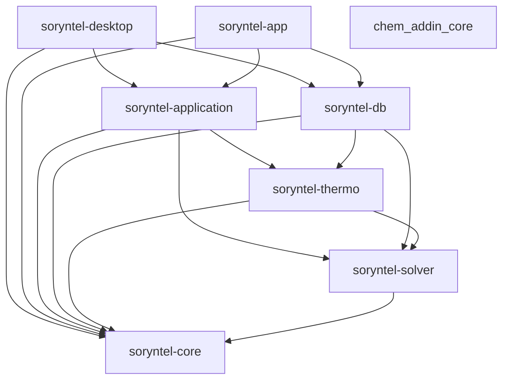

# Arquitectura de Soryntel Chemistry

El workspace Rust separa el dominio científico, los casos de uso y los adaptadores. Esta guía describe la base de `hex/models` y señala los puntos en migración. El [inventario de acoplamientos de la UI](ui-coupling-inventory.md) es un registro histórico de `cd62cbb`.

## Dependencias reales

Cada flecha representa una dependencia directa normal entre crates del workspace, tal como aparece en los manifiestos. Las dependencias externas y de desarrollo quedan fuera del diagrama.



| Crate | Responsabilidad | Límite |
|---|---|---|
| `soryntel-core` | Modelos compartidos, unidades, errores y puertos de catálogo. | Sin dependencias de otros crates Soryntel ni implementaciones de persistencia. |
| `soryntel-solver` | Parseo y balance estequiométrico. | Sin interfaz, base de datos ni orquestación de casos de uso. |
| `soryntel-thermo` | Cálculos científicos y modelos específicos de cada capacidad. | Sin adaptadores de base de datos ni UI. Consulta especies mediante puertos del núcleo. |
| `soryntel-application` | Casos de uso por capacidad, contratos de almacenamiento de proyectos, reexportación de DTO y catálogo de prueba en memoria. | Sin `soryntel-db`, egui, transporte HTTP ni locks de la composición. |
| `soryntel-db` | Catálogo en memoria por capas, lectura y escritura de formatos de catálogo e implementación de puertos. | Sin lógica de presentación ni transporte de clientes. Mantiene dependencias de thermo y solver. |
| `soryntel-app` | Adaptadores de entrada CLI y HTTP y raíz de composición. | El adaptador concreto se nombra en `composition.rs`. Los handlers usan puertos, casos de uso y DTO de application. |
| `soryntel-desktop` | Interfaz egui, arranque, archivos del usuario y bridge HTTP de Add-ins. | Sin dependencia directa de thermo ni solver: usa los DTO de `soryntel_application::models` y las operaciones de `use_cases`. La infraestructura queda en la composición. |
| `chem_addin_core` | Motor de add-ins independiente con SQLite y álgebra numérica. | Sin dependencias de los demás crates del workspace. |

## Puertos y adaptadores

Los contratos de catálogo viven en [ports.rs](../../crates/soryntel-core/src/ports.rs). La implementación reside en [soryntel-db](../../crates/soryntel-db/src/lib.rs) y sus [adaptadores](../../crates/soryntel-db/src/adapters/).

| Puerto | Adaptador |
|---|---|
| `SpeciesRepository` | `ThermoDatabase` para consultar especies y elementos de referencia. |
| `SpeciesCatalogPort` | `ThermoDatabase` para buscar, enumerar y guardar especies. |
| `SpeciesDatabaseAdminPort` | `ThermoDatabase` para administrar las capas y sus archivos. |
| `SpeciesBrowserPort` | `ThermoDatabase` para explorar registros, filtros y conjuntos de datos. |
| `OwnDbEditorPort` | `ThermoDatabase` para editar OwnDB e importar y exportar registros. |
| `ReferenceLibraryPort` | `ThermoDatabase` para cargar y consultar referencias. |
| `HscFileToolsPort` | `HscFileTools` y `ThermoDatabase` para fusionar y convertir archivos. |
| `DatabaseLocatorPort` | `DatabaseDirLocator` para localizar archivos de catálogo en un conjunto ordenado de directorios. |
| `ProjectStoragePort` | Contrato en [application](../../crates/soryntel-application/src/ports/mod.rs) para workbooks `.rea8`, `.bal8` y `.htr8`. Cableado en migración. |

`soryntel_application::testing::InMemorySpeciesCatalog` implementa `SpeciesRepository` y `SpeciesCatalogPort` para pruebas sin archivos HSC.

## Añadir una capacidad

1. Identifica los datos y las operaciones que necesita. Reutiliza un puerto del núcleo o define uno si falta un contrato de catálogo. Usa `&self` para lectura y `&mut self` para mutación.
2. Implementa el cálculo en thermo o solver y expón la operación desde [use_cases](../../crates/soryntel-application/src/use_cases/). El caso de uso recibe el puerto por parámetro. Reexporta los DTO que necesiten los clientes en [models.rs](../../crates/soryntel-application/src/models.rs).
3. Implementa el puerto en el adaptador correspondiente y conéctalo en la raíz de composición. Prueba el caso de uso con el catálogo en memoria si no depende de un formato real.
4. Conecta la UI o el handler al caso de uso. Deja la traducción a widgets, argumentos o respuestas HTTP en el adaptador de entrada. Ejecuta la auditoría de arquitectura y las pruebas del workspace.

## Qué puede llamar la UI

`soryntel-desktop` no depende de `soryntel-thermo` ni de `soryntel-solver`. Los tipos y constantes que necesita la interfaz llegan por `soryntel_application::models::<capacidad>`. Los tipos compartidos del núcleo, como `Phase`, `ChemicalSpecies` o `DbSource`, se importan desde `soryntel_core`.

La UI puede llamar directamente:

- **Constructores y valores por defecto** de los DTO reexportados, como `new`, `default`, `new_default` o `MoleculeGraph::{from_block, empty}`.
- **Getters y consultas de presentación** que solo leen el propio modelo, como `molecular_formula`, `as_display_string` o `status_flag`.
- **Edición del estado del workbook** que no calcula, como añadir, borrar o renombrar filas y hojas, o asignar campos.
- **Serde del propio workbook**, como `to_exe8_json`, `from_exe8_str` o `to_gem9_json`.

Pasan por un método de `use_cases`:

- Las **funciones libres** de thermo o solver: cálculos, parsers, búsquedas en catálogos estáticos y utilidades de formato.
- Los **métodos de cálculo o E/S** de un DTO: recalcular un workbook, resolver un balance, importar o exportar formatos externos o sondear servicios.

Estos métodos solo delegan. Los cálculos permanecen en thermo y solver, y el caso de uso mantiene la firma y el comportamiento de la función de dominio. Por ejemplo, `EquilibriumUseCases::parse_species_term` envuelve `soryntel_solver::parse_term` y `MiscUseCases::calculate_exergy` envuelve `ExergyWorkbook::calculate`.

Si falta un tipo, se añade un `pub use` en [models.rs](../../crates/soryntel-application/src/models.rs). Si falta una operación, se añade un método delegado al caso de uso de la capacidad. La regla (e) de la auditoría bloquea en modo estricto cualquier `soryntel_thermo::` o `soryntel_solver::` que quede en el escritorio fuera de `#[cfg(test)]`.

Algunos métodos de workbook con cálculo todavía se invocan desde la UI a través del tipo reexportado. Entre ellos están `calculate_results` y `normalize` de LCA, y `estimate_missing_values`, `convert_elements_to_minerals` y `calculate_*_from_rounds` de Mass Balance. No rompen la regla (e) porque no nombran el crate de dominio, pero deben pasar a casos de uso cuando se toquen esos módulos.

## Composición y concurrencia

- **Escritorio.** `main.rs` arranca el proceso y `composition.rs` crea `AppServices`, carga el catálogo y expone los servicios. En esta base, algunos módulos aún reciben el catálogo concreto mediante los accesores legacy. [Composición del escritorio](../../crates/soryntel-desktop/src/composition.rs)
- **CLI y HTTP local.** `composition.rs` carga el catálogo a través de los puertos de administración y localización. Entrega un `Arc<dyn SpeciesCatalogPort + Send + Sync>` a los adaptadores de entrada. Los hilos del servidor comparten el catálogo ya cargado mediante referencias de lectura. [Composición del CLI](../../crates/soryntel-app/src/composition.rs)
- **Bridge de Add-ins.** El arranque se origina en el escritorio, mediante `--addin-bridge` o la UI de Add-ins. El bridge es un adaptador HTTP de entrada. En esta base, el arranque desde la UI entrega un clon del catálogo y puede quedarse con una copia desactualizada. T7 cambia ese cableado y está **en migración**.

En T7 la composición de escritorio posee un `Arc<RwLock<ThermoDatabase>>`. La UI y el bridge clonan el `Arc` y comparten la misma instancia. El bridge obtiene un guard de lectura por petición y la edición de OwnDB obtiene un guard de escritura. El código de composición y los adaptadores controlan la duración de los guards. Application recibe un préstamo del puerto y desconoce el mecanismo de concurrencia. Véase el [ADR 0004](adr/0004-catalogo-compartido.md).

## Precedencia del catálogo

La política común a escritorio, bridge y CLI es **OwnDB > MainDB > OpenDefault**. Primero se crea el catálogo con los datos incluidos, luego se carga MainDB con prioridad sobre esos datos y por último se aplica OwnDB, que tiene prioridad sobre ambas capas. El bridge toma el catálogo cargado por el escritorio. El CLI usa explícitamente `MainDbPrecedence::OverrideOpenDefault` y conserva la política anterior como referencia en su prueba de regresión. [ADR 0003](adr/0003-precedencia-unificada.md)

`SORYNTEL_MAIN_DB` y `SORYNTEL_OWN_DB` configuran las rutas. Para MainDB, `--hsc-db` tiene prioridad sobre `SORYNTEL_MAIN_DB`, como fija el [ADR 0003](adr/0003-precedencia-unificada.md). Si una ruta configurada no se puede cargar, no se recurre a la ruta por defecto: el escritorio muestra el error en un aviso. Las rutas por defecto del escritorio y del CLI buscan primero en `Databases/` junto al ejecutable y después en la ruta heredada.

## Auditoría de arquitectura

Desde la raíz del repo, con Bash, Python 3 y Cargo disponibles:

```bash
bash soryntel/scripts/check_architecture.sh
bash soryntel/scripts/check_architecture.sh --report
bash soryntel/scripts/check_architecture.sh --strict
```

| Regla | Comprobación | Cuándo bloquea |
|---|---|---|
| a | El árbol normal de core carece de otros crates `soryntel-*`. | Normal y estricto |
| b | El árbol normal de application carece de `soryntel-db`, `eframe` y `egui`. | Normal y estricto |
| c | Busca referencias directas a DB en el escritorio fuera de `main.rs`, `composition.rs` y bloques `#[cfg(test)]`. | Estricto |
| d | Lista y cuenta los usos de `SoryntelApplication::` en escritorio y CLI. | Estricto |
| e | Busca `soryntel_thermo::` y `soryntel_solver::` en `soryntel-desktop/src` fuera de bloques `#[cfg(test)]`. | Estricto |
| f | Busca `soryntel_db` y `ThermoDatabase` en el CLI fuera de `composition.rs`. | Normal y estricto |

`--report` muestra los hallazgos y devuelve 0. CI usa el modo normal mientras se completa la migración del escritorio. Las búsquedas de código son textuales, por lo que los hallazgos incluyen nombres en comentarios.
